# LogiTrack

Sistema web de gestión de bodegas, productos, movimientos de inventario y auditoría, desarrollado con **Spring Boot**, **MySQL** y un frontend en **HTML, CSS y JavaScript**.

LogiTrack centraliza el control de inventario de varias bodegas, registra las operaciones realizadas por los usuarios y ofrece consultas y reportes para facilitar el seguimiento de la actividad.

## Funcionalidades

- **Autenticación:** inicio de sesión y registro con JWT.
- **Roles:** permisos diferenciados para `ADMIN` y `EMPLEADO`.
- **Bodegas:** registro, consulta, actualización y eliminación.
- **Productos:** CRUD y consulta de productos con stock bajo (menos de 10 unidades).
- **Movimientos de inventario:** entradas, salidas y transferencias entre bodegas.
- **Auditoría:** registro de operaciones y cambios realizados por los usuarios.
- **Reportes:** resumen general, stock por bodega y productos con mayor movimiento.
- **Filtros:** movimientos por rango de fechas y auditorías por usuario u operación.
- **API REST:** documentación interactiva con Swagger / OpenAPI.
- **Frontend:** interfaz web para iniciar sesión y consultar/gestionar las funcionalidades principales.

## Tecnologías

| Tecnología | Uso |
|---|---|
| Java 21 | Lenguaje de backend |
| Spring Boot | Aplicación backend y API REST |
| Spring Web MVC | Controladores REST |
| Spring Data JPA | Persistencia y consultas |
| Spring Security | Seguridad y autorización |
| JWT (JSON Web Token) | Autenticación basada en tokens |
| MySQL | Base de datos relacional |
| Maven | Gestión de dependencias y compilación |
| Swagger / OpenAPI | Documentación y exploración de endpoints |
| HTML, CSS, JavaScript | Frontend |

## Estructura del repositorio

```text
Logitrack_Proyecto/
├── Logitrack/
│   ├── src/
│   │   ├── main/
│   │   │   ├── java/com/s2/Logitrack/
│   │   │   │   ├── controller/
│   │   │   │   ├── service/
│   │   │   │   ├── repository/
│   │   │   │   ├── model/
│   │   │   │   ├── dto/
│   │   │   │   ├── config/
│   │   │   │   ├── security/
│   │   │   │   ├── mapper/
│   │   │   │   └── exception/
│   │   │   │   └── LogitrackApplication.java
│   │   │   └── resources/
│   │   │       └── application.properties
│   │   ├── pom.xml
│   │   ├── mvnw
│   │   └── mvnw.cmd
│   └── ...
├── frontend/
│   ├── index.html
│   ├── dashboard.html
│   ├── css/
│   │   └── styles.css
│   └── js/
│       ├── api.js
│       ├── login.js
│       └── dashboard.js
└── README.md
```

## Requisitos previos

Antes de ejecutar el proyecto, instala:

- [Java JDK 21](https://adoptium.net/)
- [MySQL Server](https://dev.mysql.com/downloads/mysql/)
- [Git](https://git-scm.com/)
- Navegador web moderno

## Configuración de la base de datos

1. Inicia MySQL.
2. Crea la base de datos:

```sql
CREATE DATABASE logitrack;
```

3. Configura las credenciales de conexión en `Logitrack/src/main/resources/application.properties`:

```properties
spring.datasource.url=jdbc:mysql://localhost:3306/logitrack
spring.datasource.username=TU_USUARIO
spring.datasource.password=TU_PASSWORD
```

> **Seguridad:** no subas contraseñas reales ni claves JWT al repositorio. Utiliza variables de entorno o una configuración local que no se versiona. `spring.jpa.hibernate.ddl-auto=none` está configurado, por lo que el esquema debe existir previamente. Verifica que tengas la estructura de tablas necesaria antes de iniciar la aplicación.

## Ejecutar el backend

Desde la carpeta del backend:

```bash
cd Logitrack
```

En Windows:

```bash
mvnw.cmd spring-boot:run
```

En Linux/macOS:

```bash
./mvnw spring-boot:run
```

Si Maven está instalado globalmente, también puedes ejecutar:

```bash
mvn spring-boot:run
```

La aplicación usa la configuración local de Spring Boot y, salvo que se modifique, se ejecuta en:

```text
http://localhost:8080
```

## Ejecutar el frontend

El frontend es estático (HTML, CSS y JavaScript). Puedes abrir `frontend/index.html` en el navegador o, preferiblemente, servir la carpeta `frontend/` con una extensión/servidor local como Live Server.

Asegúrate de que la URL base configurada en `frontend/js/api.js` corresponda al backend que está ejecutándose.

## API y documentación

Con el backend iniciado, abre Swagger UI:

```text
http://localhost:8080/swagger-ui/index.html
```

OpenAPI JSON:

```text
http://localhost:8080/v3/api-docs
```

### Endpoints principales

| Método | Endpoint | Descripción |
|---|---|---|
| `POST` | `/auth/login` | Iniciar sesión y obtener token |
| `POST` | `/auth/register` | Registrar usuario |
| `GET` | `/bodegas` | Consultar bodegas |
| `GET` | `/bodegas/{id}` | Consultar una bodega |
| `POST` | `/bodegas` | Crear bodega |
| `PUT` | `/bodegas/{id}` | Actualizar bodega |
| `DELETE` | `/bodegas/{id}` | Eliminar bodega |
| `GET` | `/productos` | Consultar productos |
| `GET` | `/productos/{id}` | Consultar producto |
| `GET` | `/productos/stock-bajo` | Listar productos con stock bajo |
| `POST` | `/productos` | Crear producto |
| `PUT` | `/productos/{id}` | Actualizar producto |
| `DELETE` | `/productos/{id}` | Eliminar producto |
| `POST` | `/movimientos` | Registrar movimiento de inventario |
| `GET` | `/movimientos` | Listar movimientos |
| `GET` | `/movimientos/{id}` | Consultar movimiento por ID |
| `GET` | `/movimientos/rango` | Consultar movimientos por fechas |
| `GET` | `/reportes/resumen` | Consultar resumen general |
| `GET` | `/usuarios` | Consultar usuarios |
| `POST` | `/usuarios` | Crear usuario |
| `PUT` | `/usuarios/{id}/rol` | Actualizar rol de usuario |

> Los permisos y requerimientos de cada endpoint dependen de la configuración de seguridad. Consulta Swagger para los parámetros, cuerpos de solicitud y respuestas detallados.

## Autenticación JWT

1. Envía tus credenciales al endpoint `POST /auth/login`.
2. Copia el token JWT que devuelve la API.
3. En Swagger, pulsa **Authorize** e introduce el token siguiendo el formato que indique el esquema de seguridad (normalmente `Bearer <token>`).
4. Ejecuta los endpoints protegidos con la autorización configurada.

No publiques tokens reales en capturas, repositorios ni documentación.

## Capturas de pantalla sugeridas

Guarda tus imágenes en una carpeta `docs/images/` y utiliza estos nombres para que las puedas insertar en este README:

| Nombre de archivo | Qué mostrar |
|---|---|
| `login.png` | Pantalla de inicio de sesión |
| `dashboard.png` | Dashboard con resumen/KPIs |
| `bodegas.png` | Lista o gestión de bodegas |
| `productos.png` | Catálogo de productos |
| `stock-bajo.png` | Filtro de productos con stock bajo |
| `movimiento.png` | Formulario para registrar entrada, salida o transferencia |
| `historial-movimientos.png` | Historial de movimientos con filtros de fecha |
| `auditoria.png` | Registros de auditoría y filtros |
| `reporte.png` | Reporte general, stock por bodega y productos más movidos |
| `swagger.png` | Swagger UI con endpoints desplegados |
| `swagger-auth.png` | Ejemplo de endpoint protegido autorizado con JWT |


md
## Imagenes

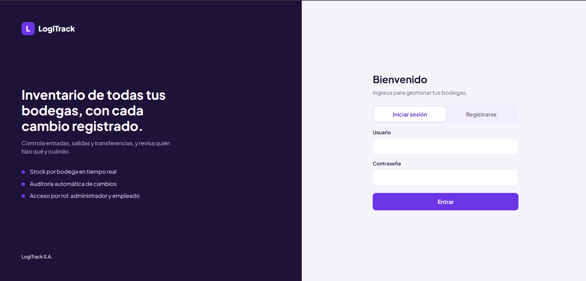

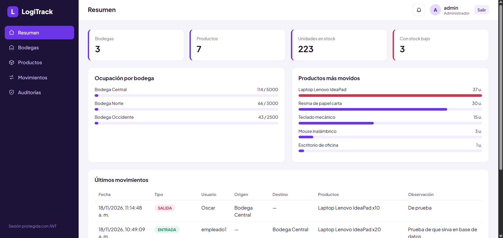

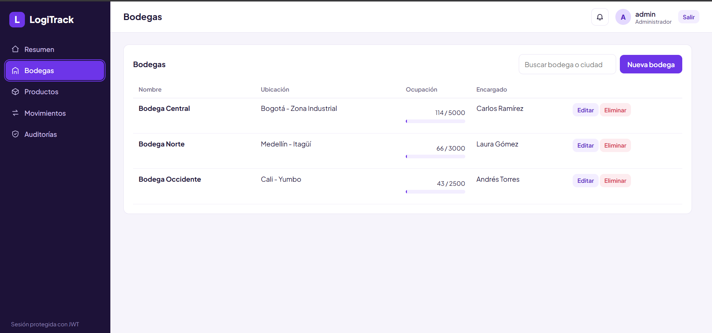

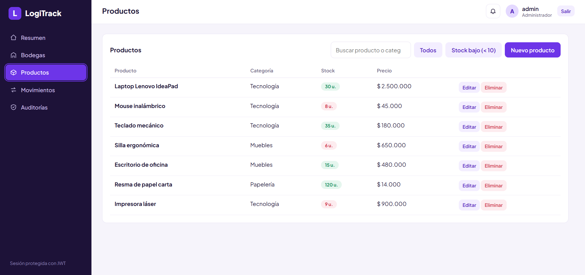

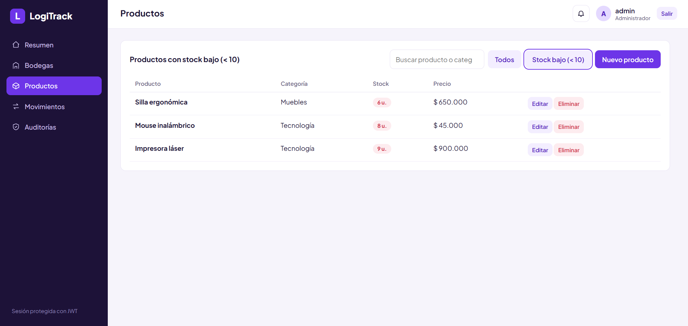

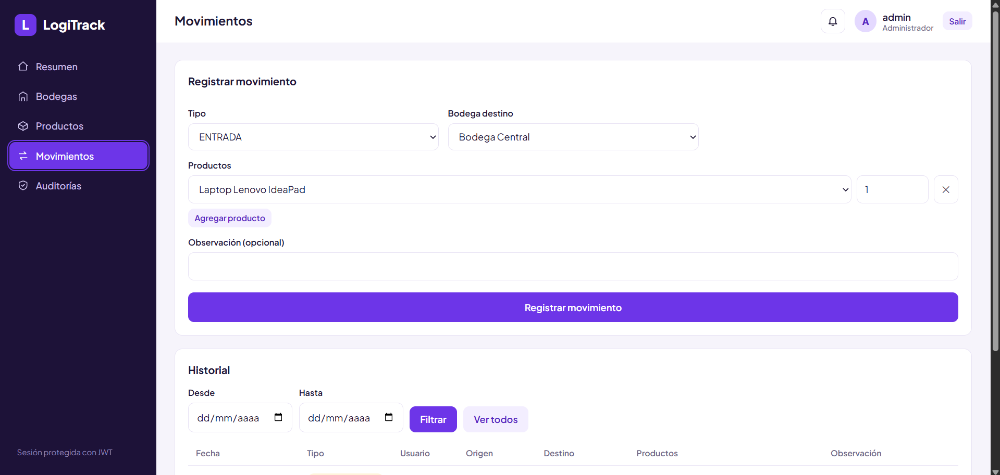

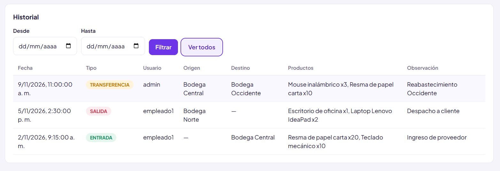

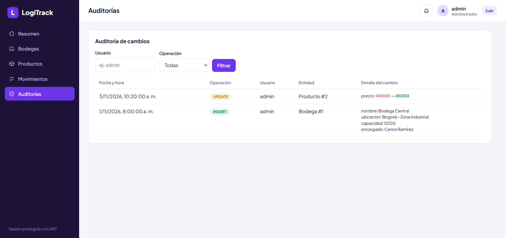

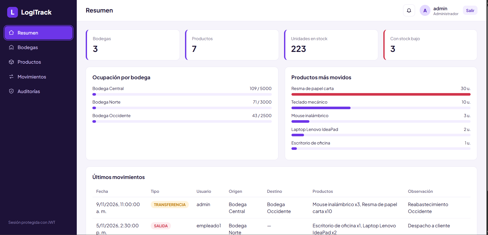

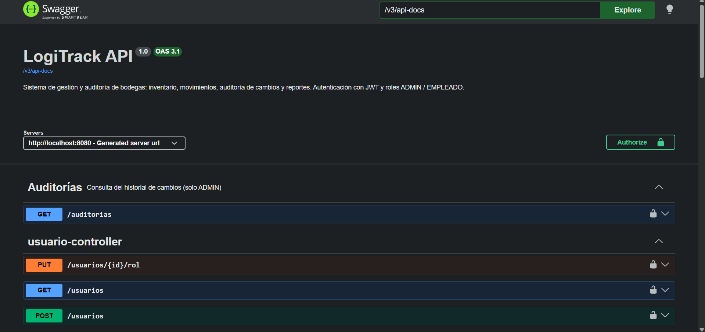

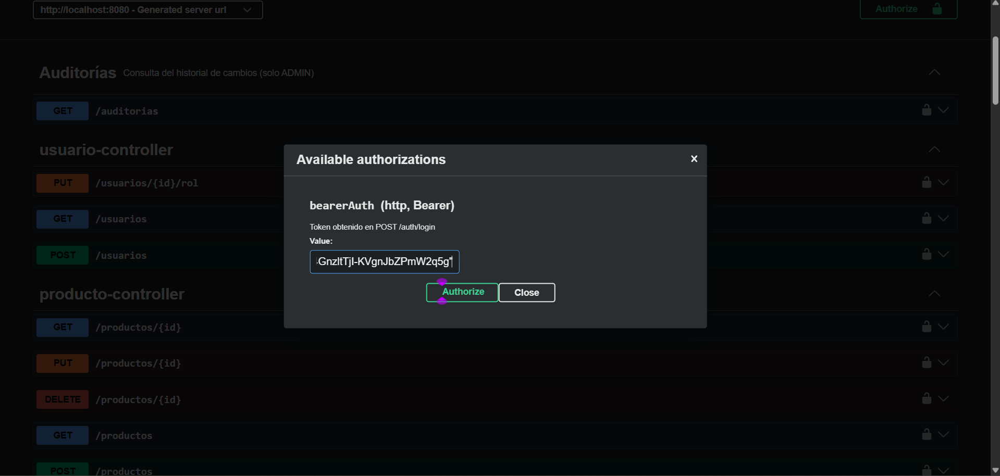


## Manejo de errores

La API utiliza respuestas de error JSON y manejo centralizado de excepciones para comunicar errores de validación, autenticación, autorización y recursos no encontrados. Los códigos HTTP pueden incluir:

- `400 Bad Request`: datos inválidos o solicitud incorrecta.
- `401 Unauthorized`: autenticación ausente o inválida.
- `403 Forbidden`: usuario autenticado sin permisos suficientes.
- `404 Not Found`: recurso inexistente.
- `500 Internal Server Error`: error inesperado del servidor.

## Equipo

Proyecto académico / de desarrollo **LogiTrack S.A.**

## Licencia

Este proyecto se desarrolló con fines académicos y demostrativos. Agrega aquí la licencia correspondiente si el repositorio va a distribuirse públicamente.
